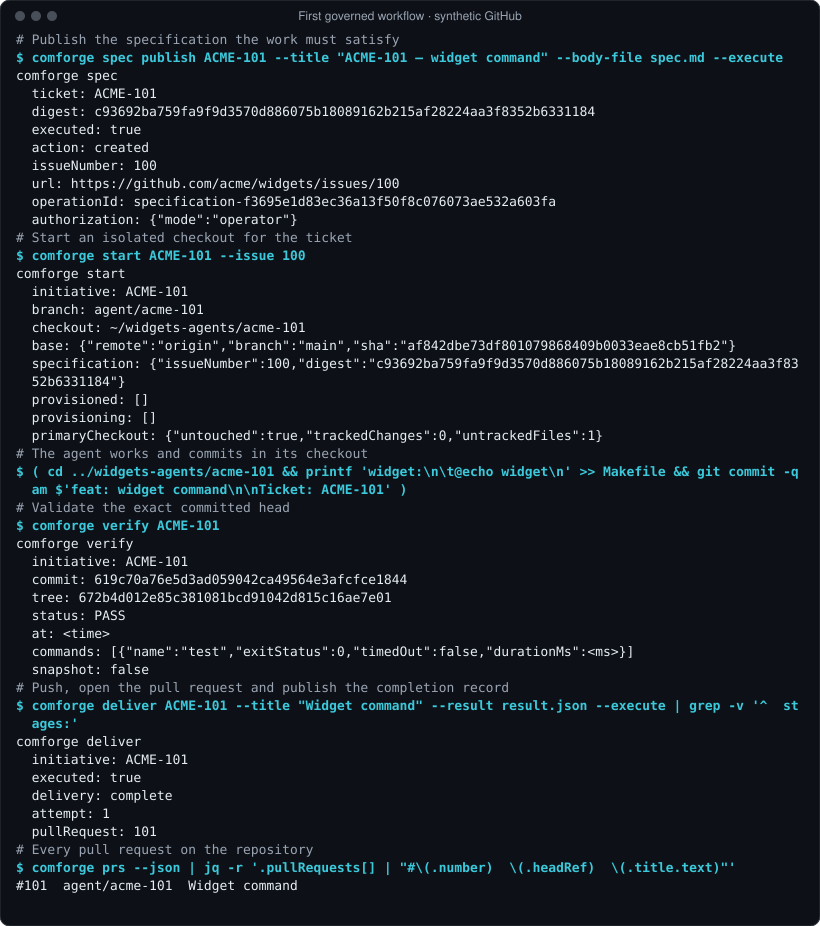
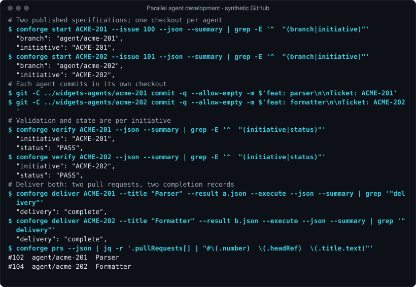
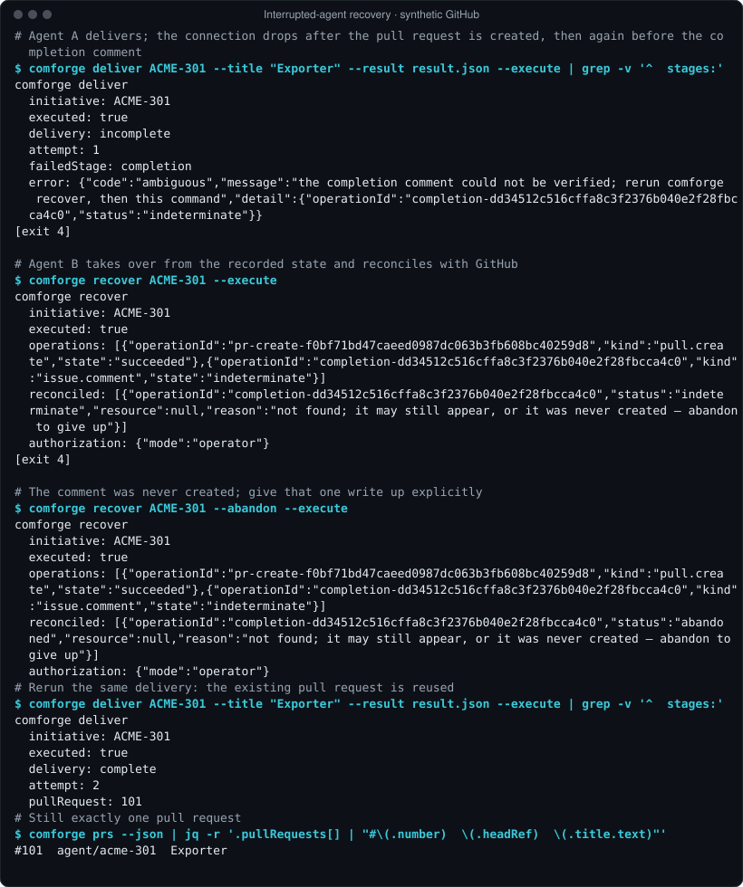
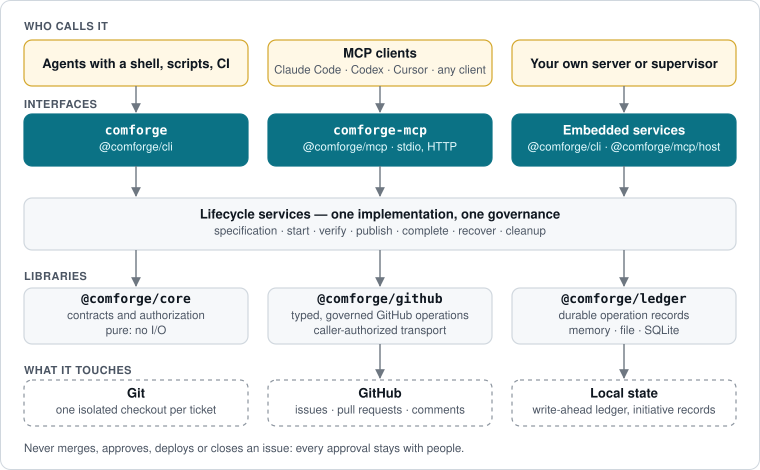
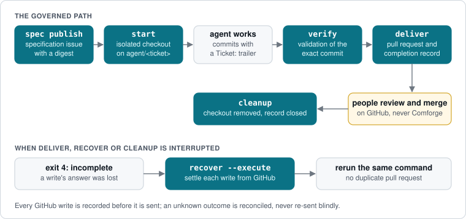
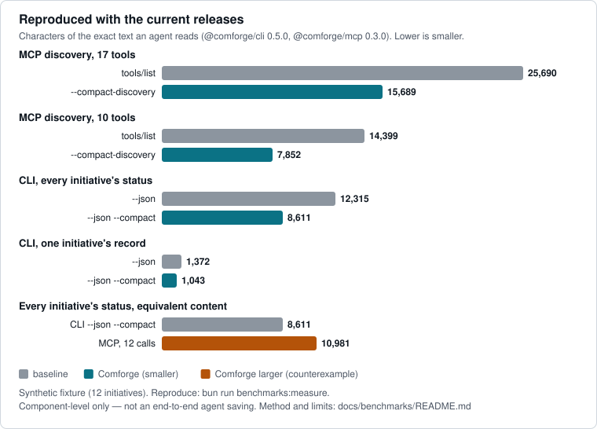

<p align="center">
  <picture>
    <source media="(prefers-color-scheme: dark)" srcset="docs/assets/brand/comforge-logo-dark.svg">
    
  </picture>
</p>

<h3 align="center">Build with agents. Govern with code.</h3>

<p align="center">
  Comforge gives coding agents a governed path from a published specification to a pull
  request: an isolated checkout per task, validation of the exact commit, recoverable GitHub
  writes and a verifiable completion record. Every approval stays with people.
</p>

<p align="center">
  <a href="https://www.npmjs.com/package/@comforge/cli"></a>
  <a href="https://www.npmjs.com/package/@comforge/mcp"></a>
  <a href="https://github.com/vikramrao1994/comforge/actions/workflows/ci.yml"></a>
  <a href="LICENSE"></a>
  <a href="docs/reference/compatibility.md"></a>
</p>

<p align="center">
  <a href="docs/getting-started/quickstart-cli.md">Quickstart</a> ·
  <a href="#examples">Examples</a> ·
  <a href="docs/recipes/README.md">Recipes</a> ·
  <a href="docs/benchmarks/summary.md">Benchmarks</a> ·
  <a href="docs/reference/README.md">API Reference</a>
</p>

## Install

```sh
npm install --save-dev --save-exact @comforge/cli @comforge/mcp
npx comforge init            # preview the configuration detected from your repository
npx comforge init --write    # write comforge.config.json; commit and push it to your base branch
npx comforge doctor          # read-only checks: runtime, Git, configuration, credential
```

Node.js ≥ 22.18 or Bun ≥ 1.4, Git ≥ 2.30, macOS or Linux, a repository on github.com or GitHub
Enterprise. Comforge reads its configuration from your base branch, never from a working tree.

## A first governed workflow

```sh
comforge spec publish ACME-101 --title "ACME-101 — widget command" --body-file spec.md --execute
comforge start ACME-101 --issue 100          # isolated checkout on agent/acme-101
#   … the agent works in that checkout and commits with a "Ticket: ACME-101" trailer …
comforge verify ACME-101                     # your validation commands, on the exact commit
comforge deliver ACME-101 --title "Widget command" --result result.json --execute
```

Real output of the last two steps, recorded against a local synthetic GitHub
([full transcript](docs/demos/first-workflow.md)):

```console
$ comforge verify ACME-101
comforge verify
  initiative: ACME-101
  commit: 619c70a76e5d3ad059042ca49564e3afcfce1844
  tree: 672b4d012e85c381081bcd91042d815c16ae7e01
  status: PASS
  at: <time>
  commands: [{"name":"test","exitStatus":0,"timedOut":false,"durationMs":<ms>}]
  snapshot: false
```

```console
$ comforge deliver ACME-101 --title "Widget command" --result result.json --execute | grep -v '^  stages:'
comforge deliver
  initiative: ACME-101
  executed: true
  delivery: complete
  attempt: 1
  pullRequest: 101
```

Every command that writes to GitHub is a dry run until you add `--execute`. The complete,
tested version, with the configuration and the completion result, is
[recipe 1](docs/recipes/01-first-governed-initiative.md).

## Why Comforge

- **Start an isolated task.** `start` checks the issue's specification digest and creates a
  fresh checkout on its own branch. Parallel agents never share a working tree.
- **Validate the exact code.** `verify` runs the validation commands from your base branch on
  the committed head and records the result against that commit, not a working tree.
- **Open pull requests safely.** `deliver` publishes only a validated head, then a completion
  record checked against the specification. Comforge never merges, approves, deploys or closes
  an issue.
- **Recover interrupted work.** Every GitHub write is recorded before it is sent. When an answer
  is lost, `recover` settles the write from what GitHub shows instead of sending it again.
- **Control agent capabilities.** The configuration declares which writes are allowed and who
  authorizes them: the operator, or an owner-signed grant per write. MCP tool profiles limit
  what a client can call.
- **Resume without losing state.** State lives in the repository, not in an agent's memory, so
  another session or agent picks up with `status` and the same commands.

## See it run

Recorded from executable scenarios against the published packages and a local synthetic
GitHub. Each has a text transcript, and CI re-records them on every pull request.

<details>
<summary><b>First governed workflow</b>: specification to pull request (<a href="docs/demos/first-workflow.md">transcript</a>)</summary>



</details>

<details>
<summary><b>Parallel agent development</b>: two tickets, two checkouts (<a href="docs/demos/parallel-agents.md">transcript</a>)</summary>



</details>

<details>
<summary><b>Interrupted-agent recovery</b>: a lost answer reconciled, no duplicate pull request (<a href="docs/demos/interrupted-recovery.md">transcript</a>)</summary>



</details>

## Choose an interface

| Interface | For | Start here |
|---|---|---|
| `comforge` CLI | agents with a shell, scripts, CI | [CLI quickstart](docs/getting-started/quickstart-cli.md) |
| `comforge-mcp` server (stdio, HTTP) | Claude Code, Codex, Cursor or any MCP client | [MCP quickstart](docs/getting-started/quickstart-mcp.md) · [integrations](docs/integrations/README.md) |
| embedded services | your own server or supervisor | [recipe 7](docs/recipes/07-embedded-host-services.md) · [API](docs/reference/api.md) |

All three call the same lifecycle services under the same governance.
[Which one to use](docs/reference/tool-selection.md).



| Package | What it is for |
|---|---|
| [`@comforge/cli`](packages/cli/README.md) | terminal workflows and embeddable lifecycle services (**start here**) |
| [`@comforge/mcp`](packages/mcp/README.md) | agent integration: the MCP server, tool profiles and host services |
| [`@comforge/core`](packages/core/README.md) | lifecycle contracts and authorization, with no I/O |
| [`@comforge/github`](packages/github/README.md) | typed, governed GitHub operations |
| [`@comforge/ledger`](packages/ledger/README.md) | durable, recoverable operation storage |

Applications depend on `@comforge/cli` and `@comforge/mcp`; the libraries come with them.

## How it works



[Architecture](docs/concepts/architecture.md) ·
[persistence and reconciliation](docs/concepts/persistence-and-reconciliation.md) ·
[authorization and trust](docs/security/authorization-and-trust.md)

## Examples

Each example consumer installs its package from the packed tarball and runs under Node.js and
Bun in CI.

| Example | Shows |
|---|---|
| [`cli-consumer`](examples/cli-consumer/README.md) | `init`, `doctor`, `start`, `verify` and `status` through the installed `comforge` executable |
| [`mcp-consumer`](examples/mcp-consumer/README.md) | an MCP client driving `comforge-mcp` over stdio for two repositories |
| [`core-consumer`](examples/core-consumer/) | specification identity and lifecycle decisions with `@comforge/core` |
| [`github-consumer`](examples/github-consumer/) | evidence reads with `@comforge/github` |
| [`ledger-consumer`](examples/ledger-consumer/) | compare-and-swap records with `@comforge/ledger` |

**Recipes** are complete tasks, each executed in CI exactly as written:
[first initiative](docs/recipes/01-first-governed-initiative.md) ·
[MCP for agents](docs/recipes/02-mcp-for-coding-agents.md) ·
[parallel initiatives](docs/recipes/03-parallel-initiatives.md) ·
[interrupted handover and recovery](docs/recipes/04-interrupted-handover-and-recovery.md) ·
[owner grants](docs/recipes/05-owner-grants.md) ·
[specification, review, revision](docs/recipes/06-specification-review-revision.md) ·
[embedded host](docs/recipes/07-embedded-host-services.md) ·
[file and SQLite persistence](docs/recipes/08-file-and-sqlite-persistence.md) ·
[a Python project](docs/recipes/09-non-typescript-project.md) ·
[governed npm release](docs/recipes/10-governed-npm-release.md) ·
[context routing](docs/recipes/11-context-routing.md)

## Benchmarks

Component-level measurements, drawn from versioned evidence. Listing pull requests through MCP
took 1,191 tokens against 2,587 for GitHub's raw REST JSON (selective retrieval, an earlier
release). Compact discovery and compact CLI output carry the same content in fewer characters.
Where MCP is *larger* than the CLI, the charts show that too. No end-to-end agent saving has
been measured.



[All charts, versions and units](docs/benchmarks/summary.md) ·
[method, provenance and limits](docs/benchmarks/README.md)

## What Comforge is not

Not an autonomous agent, a model, a sandbox, a CI system or a token-compression product.
Validation runs your code as you; isolation from untrusted code is the host's job. Recovery is
reconciliation, not an exactly-once guarantee. Windows is not supported (use WSL).
[Known limitations](docs/troubleshooting/known-limitations.md).

## Documentation

[Documentation index](docs/README.md) · [CLI reference](docs/reference/cli.md) ·
[MCP reference](docs/reference/mcp.md) · [configuration](docs/reference/configuration.md) ·
[errors](docs/reference/errors.md) · [troubleshooting](docs/troubleshooting/troubleshooting.md) ·
[`llms.txt`](llms.txt) for agents. Each package has its own `CHANGELOG.md`, for example
[`@comforge/cli`](packages/cli/CHANGELOG.md).

## Contributing

[Contributing](docs/contributing/contributing.md) ·
[release governance](docs/contributing/release-governance.md) ·
[agent instructions](CLAUDE.md). Licensed under [Apache-2.0](LICENSE).
