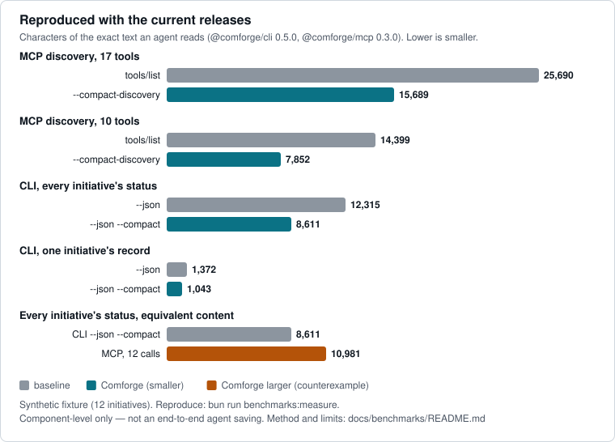
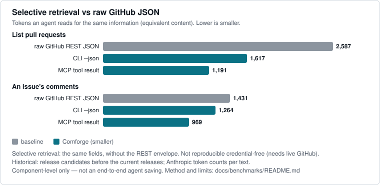
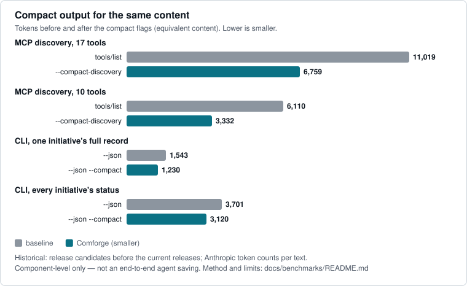
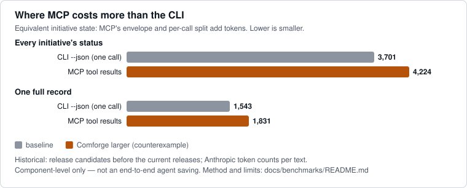

<!-- Generated by tooling/benchmarks/summary.ts from evidence/benchmarks/*.json. Do not edit; run `bun run benchmarks:summary`. -->

# Benchmark summary

Component-level measurements only. **No end-to-end agent saving, agent cost or competitive
comparison has been measured** (status: pending). Method and limits: [README](README.md).

## Reproduced now (`@comforge/cli` 0.5.0, `@comforge/mcp` 0.3.0, node v26.3.0)

Characters of the exact text an agent reads; tokens are **approximate** (`ceil(chars / 4)`,
no tokenizer). Compare ratios. Reproduce: `bun run benchmarks:measure`
(evidence: [`component-measurements.json`](../../evidence/benchmarks/component-measurements.json)).

| Measurement | Kind | Before | After | Change |
|---|---|---|---|---|
| MCP discovery, read-only (10 tools), `--compact-discovery` | equivalent | 14,399 chars | 7,852 chars | −45.5% |
| MCP discovery, executor+publisher (17 tools), `--compact-discovery` | equivalent | 25,690 chars | 15,689 chars | −38.9% |
| CLI, every initiative's status, `--compact` | equivalent | 12,315 | 8,611 | −30.1% |
| CLI, one initiative's record, `--compact` | equivalent | 1,372 | 1,043 | −24% |
| Every initiative's status: CLI JSON → MCP, one call each (12) | equivalent | 12,315 | 10,981 | −10.8% |
| Every initiative's status: CLI `--compact` → MCP, one call each | equivalent | 8,611 | 10,981 | **+27.5% (MCP larger)** |
| Every initiative: CLI full JSON → MCP status list (2 pages) | **summary, not equivalent** | 12,315 | 2,467 | −80% |
| One initiative: CLI full record → MCP status | **summary, not equivalent** | 1,372 | 915 | −33.3% |
| CLI `--json --summary`, every initiative | **summary, not equivalent** | 12,315 | 302 | — |
| CLI help + capabilities (a CLI agent's discovery, for comparison) | — | — | 11,920 | — |

Where MCP costs more: equivalent content through MCP is larger than the CLI's compact JSON,
and an MCP session pays its `tools/list` once per session; a CLI agent reads help only when
it needs it.

## Historical (earlier versions; not attributed to the current releases)

Measured before this repository existed, in the development repository of the first MCP release (an MCP context-measurement study, its revision 2) and its adoption study. Only numbers, versions and methods are reproduced here; the original evidence stays in that repository. Versions: release candidates of @comforge/mcp before 0.1.0 and of @comforge/cli between 0.2.0 and 0.4.0; not the current releases. Tokens: Anthropic messages.countTokens (model claude-opus-5-5), minus an 8-token framing; per-text counts, not a model's full context.

These are distinct component-level baselines, each against its own comparison — not one
end-to-end agent saving. *Selective retrieval* returns the fields an agent needs instead of
GitHub's full REST payload; *compact output* encodes the same content in fewer tokens; a
*summary* carries less information and is not compared with equivalent content.

| Result | Kind | Claim | Reproduced here |
|---|---|---|---|
| list pull requests: MCP comforge_prs vs CLI prs --json vs raw GitHub REST JSON (gh api) | equivalent | MCP 54.0% fewer tokens than raw GitHub, 26.3% fewer than the CLI | no — needs live GitHub: the synthetic server returns fewer fields than github.com, which would understate the raw baseline |
| an issue's comments: MCP comforge_comments vs CLI comments --json vs raw GitHub REST JSON | equivalent | MCP 32.3% fewer tokens than raw GitHub | no — needs live GitHub, as above |
| tools/list with and without --compact-discovery | equivalent (same tools; output schemas omitted) | 39–45% fewer discovery tokens | comparable measurement above (characters, current versions) |
| CLI --json vs --json --compact | equivalent | 15.7–20.3% fewer tokens | comparable measurement above (characters, current versions) |
| MCP first answer (summary) vs the CLI's full output | summary (NOT equivalent: less information) | 69–80% smaller, for an agent that needs less than everything | comparable measurement above (characters, current versions) |
| equivalent initiative state through MCP vs the CLI | equivalent | MCP 14–19% MORE tokens than the CLI's single JSON (envelope and split across calls) | comparable measurement above (characters, current versions) |
| --summary on a tiny result (recovery report) | summary | a very small result grows by its summary marker | comparable measurement above (characters, current versions) |
| comforge_context over the development repository's manifest | regression check | 15 of 15 cases routed as expected; expectations set by the implementer | no — that manifest is private; this repository has its own evaluation set |
| copy an example consumer into an empty directory, install from npm with an empty cache, run its checks | machine time | machine time only; excludes a person reading the README and writing a configuration | no — needs the npm registry |

## Regression checks (run in CI on every pull request)

| Check | Where |
|---|---|
| Context routing: 26 cases must route exactly (written with the manifest; a regression check, not an independent benchmark) | `bun run validate routing` |
| Ledger conformance and concurrency (memory, file, SQLite) | `packages/ledger/test`, `tests/ledger` |
| Lost answers, interrupted writes, concurrent deliveries | `packages/cli/test/recovery.test.ts` |
| Executable recipes against the published harness | `tests/docs/recipes.test.ts` |
