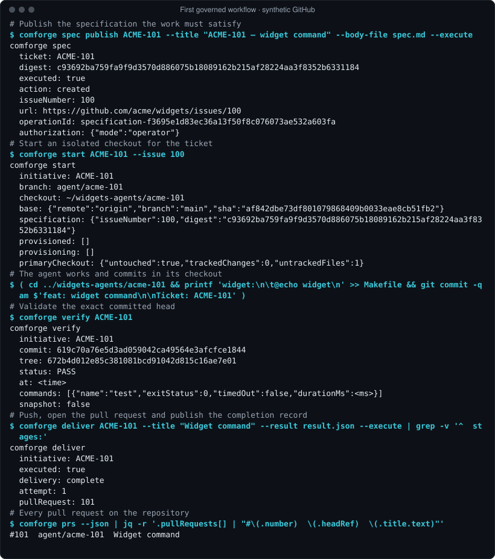

<!-- Generated by tooling/demos/demos.ts. Do not edit; run `bun tooling/demos/demos.ts`. -->

# Demo: First governed workflow

One ticket from a published specification to a pull request with a completion record.



**What this is.** The real output of an executable scenario, recorded with the published
`@comforge/cli` 0.5.0, `@comforge/mcp` 0.3.0 against a **local synthetic GitHub** (127.0.0.1, repository `acme/widgets`):
nothing reaches github.com, and the credential is synthetic. Setup steps that are not shown
(writing the configuration and completion result) follow
[the recipe](../recipes/01-first-governed-initiative.md). Normalized: the temporary directory is shown as `~`,
timestamps as `<time>` and durations as `<ms>`. Commands run with `set -o pipefail`, so a display filter
(`grep`, `jq`) never hides an exit status. CI re-records it and fails on any difference (`bun run validate demos`).

## Text transcript

```console
# Publish the specification the work must satisfy
$ comforge spec publish ACME-101 --title "ACME-101 — widget command" --body-file spec.md --execute
comforge spec
  ticket: ACME-101
  digest: c93692ba759fa9f9d3570d886075b18089162b215af28224aa3f8352b6331184
  executed: true
  action: created
  issueNumber: 100
  url: https://github.com/acme/widgets/issues/100
  operationId: specification-f3695e1d83ec36a13f50f8c076073ae532a603fa
  authorization: {"mode":"operator"}
# Start an isolated checkout for the ticket
$ comforge start ACME-101 --issue 100
comforge start
  initiative: ACME-101
  branch: agent/acme-101
  checkout: ~/widgets-agents/acme-101
  base: {"remote":"origin","branch":"main","sha":"af842dbe73df801079868409b0033eae8cb51fb2"}
  specification: {"issueNumber":100,"digest":"c93692ba759fa9f9d3570d886075b18089162b215af28224aa3f8352b6331184"}
  provisioned: []
  provisioning: []
  primaryCheckout: {"untouched":true,"trackedChanges":0,"untrackedFiles":1}
# The agent works and commits in its checkout
$ ( cd ../widgets-agents/acme-101 && printf 'widget:\n\t@echo widget\n' >> Makefile && git commit -qam $'feat: widget command\n\nTicket: ACME-101' )
# Validate the exact committed head
$ comforge verify ACME-101
comforge verify
  initiative: ACME-101
  commit: 619c70a76e5d3ad059042ca49564e3afcfce1844
  tree: 672b4d012e85c381081bcd91042d815c16ae7e01
  status: PASS
  at: <time>
  commands: [{"name":"test","exitStatus":0,"timedOut":false,"durationMs":<ms>}]
  snapshot: false
# Push, open the pull request and publish the completion record
$ comforge deliver ACME-101 --title "Widget command" --result result.json --execute | grep -v '^  stages:'
comforge deliver
  initiative: ACME-101
  executed: true
  delivery: complete
  attempt: 1
  pullRequest: 101
# Every pull request on the repository
$ comforge prs --json | jq -r '.pullRequests[] | "#\(.number)  \(.headRef)  \(.title.text)"'
#101  agent/acme-101  Widget command
```
