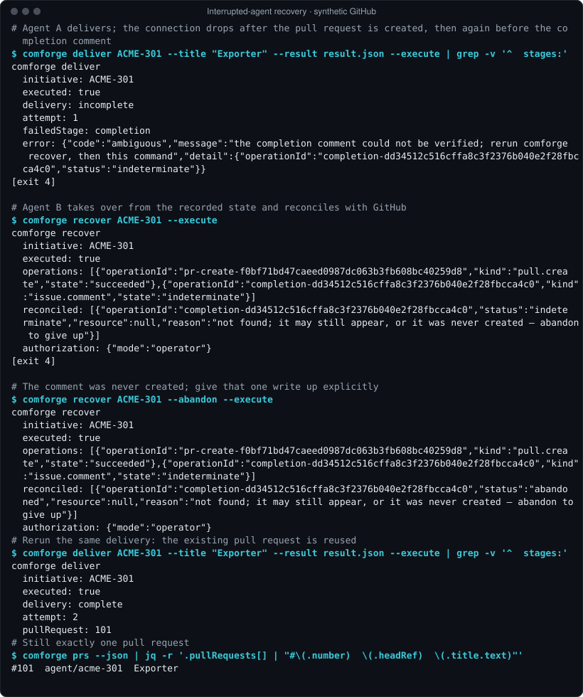

<!-- Generated by tooling/demos/demos.ts. Do not edit; run `bun tooling/demos/demos.ts`. -->

# Demo: Interrupted-agent recovery

A delivery is cut off after GitHub applied a write but before its answer arrived. A second agent reconciles from the recorded state and finishes, without a duplicate pull request.



**What this is.** The real output of an executable scenario, recorded with the published
`@comforge/cli` 0.6.0, `@comforge/mcp` 0.4.0 against a **local synthetic GitHub** (127.0.0.1, repository `acme/widgets`):
nothing reaches github.com, and the credential is synthetic. Setup steps that are not shown
(writing the configuration and completion result) follow
[the recipe](../recipes/04-interrupted-handover-and-recovery.md). Normalized: the temporary directory is shown as `~`,
timestamps as `<time>` and durations as `<ms>`. Commands run with `set -o pipefail`, so a display filter
(`grep`, `jq`) never hides an exit status. CI re-records it and fails on any difference (`bun run validate demos`).

## Text transcript

```console
# Agent A delivers; the connection drops after the pull request is created, then again before the completion comment
$ comforge deliver ACME-301 --title "Exporter" --result result.json --execute | grep -v '^  stages:'
comforge deliver
  initiative: ACME-301
  executed: true
  delivery: incomplete
  attempt: 1
  failedStage: completion
  error: {"code":"ambiguous","message":"the completion comment could not be verified; rerun comforge recover, then this command","detail":{"operationId":"completion-dd34512c516cffa8c3f2376b040e2f28fbcca4c0","status":"indeterminate"}}
[exit 4]
# Agent B takes over from the recorded state and reconciles with GitHub
$ comforge recover ACME-301 --execute
comforge recover
  initiative: ACME-301
  executed: true
  operations: [{"operationId":"pr-create-f0bf71bd47caeed0987dc063b3fb608bc40259d8","kind":"pull.create","state":"succeeded"},{"operationId":"completion-dd34512c516cffa8c3f2376b040e2f28fbcca4c0","kind":"issue.comment","state":"indeterminate"}]
  reconciled: [{"operationId":"completion-dd34512c516cffa8c3f2376b040e2f28fbcca4c0","status":"indeterminate","resource":null,"reason":"not found; it may still appear, or it was never created — abandon to give up"}]
  authorization: {"mode":"operator"}
[exit 4]
# The comment was never created; give that one write up explicitly
$ comforge recover ACME-301 --abandon --execute
comforge recover
  initiative: ACME-301
  executed: true
  operations: [{"operationId":"pr-create-f0bf71bd47caeed0987dc063b3fb608bc40259d8","kind":"pull.create","state":"succeeded"},{"operationId":"completion-dd34512c516cffa8c3f2376b040e2f28fbcca4c0","kind":"issue.comment","state":"indeterminate"}]
  reconciled: [{"operationId":"completion-dd34512c516cffa8c3f2376b040e2f28fbcca4c0","status":"abandoned","resource":null,"reason":"not found; it may still appear, or it was never created — abandon to give up"}]
  authorization: {"mode":"operator"}
# Rerun the same delivery: the existing pull request is reused
$ comforge deliver ACME-301 --title "Exporter" --result result.json --execute | grep -v '^  stages:'
comforge deliver
  initiative: ACME-301
  executed: true
  delivery: complete
  attempt: 2
  pullRequest: 101
# Still exactly one pull request
$ comforge prs --json | jq -r '.pullRequests[] | "#\(.number)  \(.headRef)  \(.title.text)"'
#101  agent/acme-301  Exporter
```
