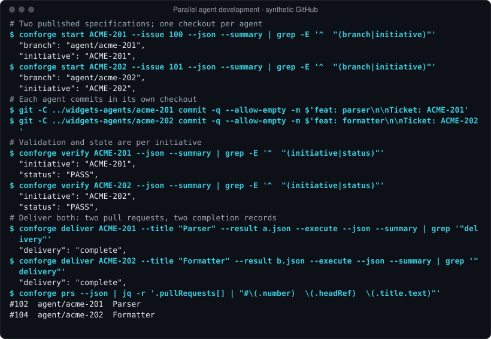

<!-- Generated by tooling/demos/demos.ts. Do not edit; run `bun tooling/demos/demos.ts`. -->

# Demo: Parallel agent development

Two agents work on two tickets at once, each in its own checkout, with no shared working tree.



**What this is.** The real output of an executable scenario, recorded with the published
`@comforge/cli` 0.5.0, `@comforge/mcp` 0.3.0 against a **local synthetic GitHub** (127.0.0.1, repository `acme/widgets`):
nothing reaches github.com, and the credential is synthetic. Setup steps that are not shown
(writing the configuration and completion result) follow
[the recipe](../recipes/03-parallel-initiatives.md). Normalized: the temporary directory is shown as `~`,
timestamps as `<time>` and durations as `<ms>`. Commands run with `set -o pipefail`, so a display filter
(`grep`, `jq`) never hides an exit status. CI re-records it and fails on any difference (`bun run validate demos`).

## Text transcript

```console
# Two published specifications; one checkout per agent
$ comforge start ACME-201 --issue 100 --json --summary | grep -E '^  "(branch|initiative)"'
  "branch": "agent/acme-201",
  "initiative": "ACME-201",
$ comforge start ACME-202 --issue 101 --json --summary | grep -E '^  "(branch|initiative)"'
  "branch": "agent/acme-202",
  "initiative": "ACME-202",
# Each agent commits in its own checkout
$ git -C ../widgets-agents/acme-201 commit -q --allow-empty -m $'feat: parser\n\nTicket: ACME-201'
$ git -C ../widgets-agents/acme-202 commit -q --allow-empty -m $'feat: formatter\n\nTicket: ACME-202'
# Validation and state are per initiative
$ comforge verify ACME-201 --json --summary | grep -E '^  "(initiative|status)"'
  "initiative": "ACME-201",
  "status": "PASS",
$ comforge verify ACME-202 --json --summary | grep -E '^  "(initiative|status)"'
  "initiative": "ACME-202",
  "status": "PASS",
# Deliver both: two pull requests, two completion records
$ comforge deliver ACME-201 --title "Parser" --result a.json --execute --json --summary | grep '"delivery"'
  "delivery": "complete",
$ comforge deliver ACME-202 --title "Formatter" --result b.json --execute --json --summary | grep '"delivery"'
  "delivery": "complete",
$ comforge prs --json | jq -r '.pullRequests[] | "#\(.number)  \(.headRef)  \(.title.text)"'
#102  agent/acme-201  Parser
#104  agent/acme-202  Formatter
```
